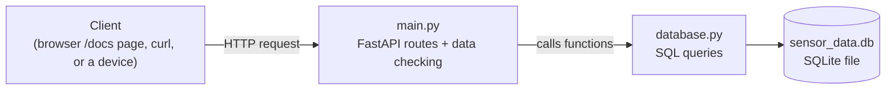

# Sensor Data REST API

A REST API that stores and searches IoT sensor readings (temperature, humidity, motion) in a database. I built it after my simulator project, because that one lost all its data when it restarted. This one saves everything in a SQLite file.

## What it does

You can send it a reading, list readings, filter them, get one by id, delete one, and see simple statistics. It also rejects wrong data, for example humidity of 150%.

## Block diagram



## Endpoints

| Method | URL | What it does |
|---|---|---|
| POST | `/readings` | Save a new reading |
| GET | `/readings` | List readings (newest first). Optional filters: `device_id`, `start_time`, `end_time`, `limit` |
| GET | `/readings/{id}` | Get one reading |
| DELETE | `/readings/{id}` | Delete one reading |
| GET | `/stats` | Count, average / min / max temperature, average humidity, motion events |

## How to run

1. Install the packages:
   ```
   pip install -r requirements.txt
   ```
2. Start the server:
   ```
   uvicorn main:app --reload
   ```
3. Open http://127.0.0.1:8000/docs. FastAPI makes this page automatically, and you can test every endpoint by clicking "Try it out".

Example reading to send with POST:
```
{
  "device_id": "sim-device-01",
  "temperature_c": 28.5,
  "humidity_pct": 60,
  "motion_detected": true
}
```

## Files

| File | What it does |
|---|---|
| `main.py` | The API: routes and checking of incoming data |
| `database.py` | All the SQL code (create table, insert, search, delete, stats) |
| `requirements.txt` | Python packages needed |

The database file `sensor_data.db` is created automatically the first time the server starts.

## Built with

Python, FastAPI, Pydantic, SQLite, uvicorn

## What I learned

- **Why a database.** My first project kept readings in memory and lost them on restart. SQLite saves them in a file, so they stay.
- **Data checking.** Pydantic checks every request. Temperature must be between -40 and 125 and humidity between 0 and 100, otherwise the API sends back an error and nothing is saved.
- **SQL injection.** I used `?` placeholders in the SQL instead of joining user input into the query text, so a user cannot sneak in their own SQL.
- **Two files, two jobs.** `main.py` does not contain SQL and `database.py` does not know about HTTP. If I change the database later, I only change `database.py`.
- **Status codes.** 201 means something was created, 204 means deleted with nothing to return, and 404 means not found.

## Limits

- No login, so anyone who can reach the server can add or delete readings.
- Only a simple `limit` for results, with no page numbers.
- SQLite is fine for learning, but a real product with many devices would need something stronger.

## Next: `iot-alert-system`

That project reads from this API and raises alerts when readings look dangerous.
